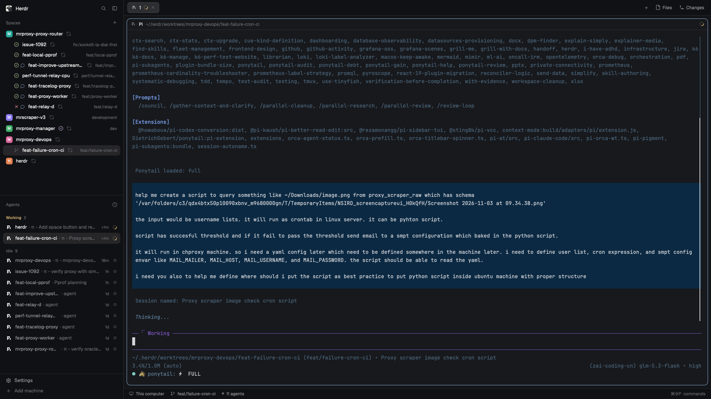

# GitHub Spaces

GitHub behind the Spaces sidebar: which PR each checkout is on, how its checks stand, which human comments still need attention, and the comment cards and notifications that follow.

This mod draws no rows and no marks. It publishes what it knows to shared state, and the sidebar mod draws it. Install it with [`spaces-stacks`](../spaces-stacks/README.md), which renders the spaces, the PR marks and the fetch arrow.



## Install

Requires Herdr, Git, and [GitHub CLI](https://cli.github.com/) authenticated with access to your repositories.

1. Check GitHub access with `gh auth status`.
2. Copy both mods into Herdr's configuration directory. Back up an existing installation first; this replaces its files.

   ```sh
   mkdir -p ~/.config/herdr-app/mods
   cp -R spaces-stacks/mods/spaces-stacks ~/.config/herdr-app/mods/
   cp -R github-spaces/mods/github-spaces ~/.config/herdr-app/mods/
   ```

   If you use `HERDR_APP_HOME`, use that directory instead of `~/.config/herdr-app`.

3. Point the sidebar at `spaces-stacks` (`{ "mod": "spaces-stacks" }`) and mount this mod as a 1px background block, exactly as the [Spaces Stacks install](../spaces-stacks/README.md#install) describes. It draws nothing; without a mount it never polls.

4. Add the comment-card blocks if you want the cards: five `floating` entries in the work area, `props: { "role": "comment", "slot": 0..4 }` (see [Comment cards](#comment-cards)).

5. Validate:

   ```sh
   herdr-app check ~/.config/herdr-app/mods/github-spaces
   herdr-app check ~/.config/herdr-app/mods/spaces-stacks
   herdr-app status
   ```

Herdr reloads saved changes automatically. PR lookups run every two minutes, including in the background; allow a polling cycle for marks to appear.

Known PRs are refreshed with one batched request per repository. Comment history is fetched only when the PR reports a change, and thread resolution is re-read while a badge is showing. Merged and closed PRs are re-resolved every 30 minutes. If the shared GraphQL budget runs out, polling pauses until it resets — hover **Spaces** for the resume time; marks stay as they were.

## Read the marks

The sidebar draws these from this mod's answers:

| Mark | Meaning |
| --- | --- |
| Orange crossing-branches icon with an exclamation mark | PR conflicts with its base branch; takes priority over CI |
| Red cross | Checks failed |
| Yellow spinner | Checks running or pending |
| Green circle-check | Checks classified as passing |
| Blue shield-check beside the CI icon | Open PR is approved (GitHub review decision `APPROVED`) |
| Purple circle-check | PR merged (worktree rows only; plain spaces show open PRs only) |
| Grey minus | PR closed without merging |
| Original icon | No known PR for the branch |

Hover a mark for its PR number and status. **💬 N** counts pending human comments, including comments older than the five shown as cards.

Four things lower the count: GitHub review threads resolving, you closing that comment's card, the PR closing/merging, or **a commit pushed after the comment** (only comments newer than the PR's latest commit count; the cards stay). Opening the space or following a link changes nothing. Comments beyond the latest five cannot be closed from a card; they leave the count only through resolution. Bot accounts never count.

Conflict detection uses GitHub's mergeability result, not local ahead/behind counts. If GitHub reports `UNKNOWN`, the usual CI mark remains until a later poll confirms a conflict. Merged and closed marks take priority over conflicts.

The PR's base branch is published too; the sidebar uses it to nest stacked worktrees.

## Comment cards

Each human comment on the selected worktree's PR is its own floating block (newest = slot 0): author, UTC timestamp, up to 300 characters, and a **View on GitHub ↗** link. Every card has its own frame and drag spot, so dragging one moves only that card. Up to five cards show; unused slots render nothing and collapse.

Press **×** to close a card — the sidebar count drops by one. Closing never removes it from GitHub. Switching worktrees swaps the cards; returning restores them. Shared storage preserves closed cards across restarts.

Add five `floating` entries (slot 0–4) to the work-area block in your personal layout:

```json
"floating": [
  { "id": "github-spaces-comment-0", "content": { "mod": "github-spaces", "props": { "role": "comment", "slot": 0 } }, "edge": "bottom", "align": "end" },
  { "id": "github-spaces-comment-1", "content": { "mod": "github-spaces", "props": { "role": "comment", "slot": 1 } }, "edge": "bottom", "align": "end" }
]
```

(…and likewise slots 2, 3, 4.) The cards use `dock.js` in the same mod folder. They do not run a second poller. Attach the floating block to the work area (above the status bar), not the terminal block, or it covers the terminal's status line.

## Notifications

- A new human comment on a PR triggers a Herdr notification (stays up 15 seconds) ("PR #N: <author> commented"); clicking it selects that space. A comment that arrived while Herdr was closed notifies once after restart; a space with no saved comments yet (first install) stays quiet. PR marks refresh within seconds of a reload, once each branch is known.
- A newly observed merge triggers a toast. For a linked worktree, Herdr's existing removal dialog also opens.
- Removal requires confirmation. The dialog warns about local changes; removal closes the space and deletes the checkout. The branch remains.
- Previously handled merges are remembered. Main checkouts are never offered for removal by this mod.

## Refresh key

Bind a key to re-check git and every PR now instead of waiting for the two-minute poll. Add to the `global` section of `~/.config/herdr-app/keys.json`:

```json
"cmd-shift-r": "github-spaces.refresh"
```

It also asks the sidebar to re-read its checkouts. A space whose PR was asked for in the last 30 seconds is skipped, so repeated presses stay cheap on the GitHub API.

## Limits and troubleshooting

- **No PR marks:** wait for a polling cycle, then run `gh pr view` from the checkout. Confirm the branch has a PR and `gh` has access. If the sidebar never publishes `spaces.git` (older layout, `spaces` still mounted), this mod has nothing to answer for and stays silent.
- **Remote spaces:** `gh` runs on that space's machine. A place whose folder is gone retries with its own growing delay; a machine where `gh` is missing or not signed in pauses for 30 minutes. Authentication failures also prevent fresh results.
- **Rate limits:** the GraphQL budget is read from the answers themselves. Below 120 points, polling stops until the reset time and the **Spaces** header says when it resumes. Marks keep their last value.
- **Checks:** an empty check list currently counts as passing. Green is not a guarantee of merge readiness.
- **Comments:** discussion comments, nonempty submitted review summaries, and inline replies are checked every two minutes. Bot accounts, usernames containing `bot` (case-insensitive), your own account's comments, and the PR creator's comments are excluded from both cards and badge. A commit newer than a comment clears it from the badge (cards remain). Edits are not tracked. Own-comment filtering uses the local `gh` account, which may differ from a remote machine's account.
- **Installed copies:** `~/.config/herdr-app/mods/github-spaces` is a copy, not a link. Sync after changes here.

This is trusted code: it queries GitHub, reads repository state, and runs `gh`. Status changes alone do not fetch, rebase, push, or remove worktrees. Removal requires confirmation.

## Shared state

| Key | This mod | The sidebar |
| --- | --- | --- |
| `spaces.git` | reads | writes |
| `github-spaces.prs` | writes | reads |
| `github-spaces.comments` | writes | reads (dismissed cards) |
| `github-spaces.hold` | writes | reads (rate-limit tooltip) |

`github-spaces.prs` maps `` `${repo}|${branch}` `` to `{ number, url, state, base, conflict, ci, approved, attentionIds }`; `base` is the PR's `baseRefName`. Values are written only when they change, because a write re-renders every mod.

## Development

Start with [`mods/github-spaces/main.js`](mods/github-spaces/main.js). The [recipe](RECIPE.md) describes both mods and their contract. The sidebar's own behaviour lives in [`spaces-stacks`](../spaces-stacks/README.md).

From the repository root:

```sh
node github-spaces/test-branch-status.cjs
node spaces-stacks/test-stacks.cjs
git diff --check
```

The regression check verifies conflict precedence, five-comment ordering, bot filtering, attention counts, resolution, author commits, links, pagination, partial API failures, batching, moved branches, budget pauses, and explicit dock dismissal. Disposable Git repositories cover the sidebar's branch arrows. It does not touch your working branches. Also run Herdr's check on both installed mods and inspect the live sidebar; headless checks do not cover every later render state.
