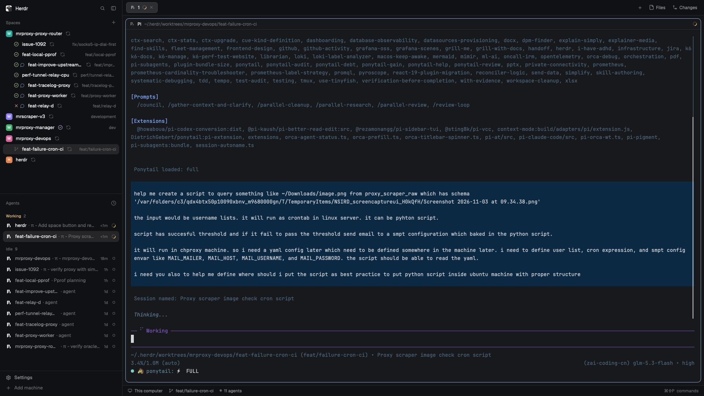

# GitHub Spaces

The Herdr Spaces sidebar with PR status, comment badges, merged-worktree cleanup prompts, and a fetch/rebase button.



Keeps space selection, drag-to-reorder, right-click menus, machine groups, and nested worktree rows.

## Install

Requires Herdr, Git, and [GitHub CLI](https://cli.github.com/) authenticated with access to your repositories.

1. Check GitHub access with `gh auth status`.
2. From this repository's root, copy the mod into Herdr's configuration directory. Back up an existing installation first; this replaces its files.

   ```sh
   mkdir -p ~/.config/herdr-app/mods
   cp -R github-spaces/mods/github-spaces ~/.config/herdr-app/mods/
   ```

   If you use `HERDR_APP_HOME`, use that directory instead of `~/.config/herdr-app`.

3. In your **personal layout**, change the spaces block's `content` to:

   ```json
   { "mod": "github-spaces" }
   ```

   Do not edit a shipped layout. If you use the shipped `main` layout, clone it first; this also switches to the clone:

   ```sh
   herdr-app do layout.clone '{"name":"main","as":"main-github"}'
   ```

   Edit `layouts/main-github.json` under your Herdr configuration directory. No other panels or key bindings need changing.

4. Validate the installed mod:

   ```sh
   herdr-app check ~/.config/herdr-app/mods/github-spaces
   herdr-app status
   ```

Herdr reloads saved changes automatically. PR lookups run every two minutes, including in the background; allow a polling cycle for marks to appear.

## Read the sidebar

### PR marks

| Mark | Meaning |
| --- | --- |
| Orange crossing-branches icon with an exclamation mark | PR conflicts with its base branch; takes priority over CI |
| Red cross | Checks failed |
| Yellow spinner | Checks running or pending |
| Green circle-check | Checks classified as passing |
| Blue shield-check beside the CI icon | Open PR is approved (GitHub review decision `APPROVED`) |
| Purple circle-check | PR merged (worktree rows only; plain spaces show open PRs only) |
| Grey minus | PR closed without merging |
| Original icon | No known PR for the branch |

Hover a mark for its PR number and status. **💬 N** counts pending human comments, including comments older than the five shown as cards.

Four things lower the count: GitHub review threads resolving, you closing that comment's card, the PR closing/merging, or **a commit pushed after the comment** (only comments newer than the PR's latest commit count; the cards stay). Opening the space or following a link changes nothing. Comments beyond the latest five cannot be closed from a card; they leave the count only through resolution. Bot accounts never count.

Conflict detection uses GitHub's mergeability result, not local ahead/behind counts. If GitHub reports `UNKNOWN`, the usual CI mark remains until a later poll confirms a conflict. Merged and closed marks take priority over conflicts.

### Fetch/rebase button

| Appearance | Meaning |
| --- | --- |
| Blue arrow | Default; not a guarantee that the branch is up to date |
| Red arrow + count | Behind the configured upstream, with no local-only commits |
| Blue arrow + divergence tooltip | Both ahead and behind; inspect history before rebasing or pushing |
| Spinning arrow | Fetch/rebase started by this mod is running |

Clicking the arrow runs `git fetch`, then `git rebase` against the branch's configured upstream. It does not push or resolve conflicts. Errors appear as toasts; conflicts can leave a rebase paused for you to finish or abort.

The row's `↑N ↓N` values are Git's raw commit counts. They compare local history with the **last fetched upstream**, not the PR's base branch. After rebasing, both counts can be nonzero. The mod does not automatically fetch or detect rebases started in another terminal.

## Notifications and cleanup

### Refresh key

Bind a key to re-check every space's branch and PR now instead of waiting for the two-minute poll. Add to the `global` section of `~/.config/herdr-app/keys.json`:

```json
"cmd-shift-r": "github-spaces.refresh"
```

A space whose PR was asked for in the last 30 seconds is skipped, so repeated presses stay cheap on the GitHub API.

### Persistent comment cards

Each human comment on the selected worktree's PR is its own floating block (newest = slot 0): author, UTC timestamp, up to 300 characters, and a **View on GitHub ↗** link. Every card has its own frame and drag spot, so dragging one moves only that card. Up to five cards show; unused slots render nothing and collapse.

Press **×** to close a card — the sidebar count drops by one. Closing never removes it from GitHub. Switching worktrees swaps the cards; returning restores them. Shared storage preserves closed cards across restarts.

Add five `floating` entries (slot 0–4) to the work-area block in your personal layout:

```json
"floating": [
  { "id": "github-spaces-comment-0", "content": { "mod": "github-spaces", "props": { "role": "comment", "slot": 0 } }, "edge": "bottom", "align": "end" },
  { "id": "github-spaces-comment-1", "content": { "mod": "github-spaces", "props": { "role": "comment", "slot": 1 } }, "edge": "bottom", "align": "end" }
]
```

(…and likewise slots 2, 3, 4.) The cards use `dock.js` in the same mod folder. It does not run a second poller. Attach the floating block to the work area (above the status bar), not the terminal block, or it covers the terminal's status line.

- New latest comments update the persistent card. Merge and error notifications retain their existing behavior.
- A new human comment on a PR triggers a Herdr notification (stays up 15 seconds) ("PR #N: <author> commented"); clicking it selects that space. A comment that arrived while Herdr was closed notifies once after restart; a space with no saved comments yet (first install) stays quiet. PR marks refresh within seconds of a reload, once each branch is known.
- A newly observed merge triggers a toast. For a linked worktree, Herdr's existing removal dialog also opens.
- Removal requires confirmation. The dialog warns about local changes; removal closes the space and deletes the checkout. The branch remains.
- Previously handled merges are remembered. Main checkouts are never offered for removal by this mod.

## Limits and troubleshooting

- **No PR marks:** wait for a polling cycle, then run `gh pr view` from the checkout. Confirm the branch has a PR and `gh` has access.
- **Remote spaces:** Git and `gh` run on that space's machine. If `gh` cannot start, lookups on that machine pause for 30 minutes. Authentication failures also prevent fresh results.
- **Unexpected grouping:** the mod uses the first terminal's live folder, falling back to the saved folder—not the space's display name.
- **Checks:** an empty check list currently counts as passing. Green is not a guarantee of merge readiness.
- **Comments:** discussion comments, nonempty submitted review summaries, and inline replies are checked every two minutes. Bot accounts, usernames containing `bot` (case-insensitive), your own account's comments, and the PR creator's comments are excluded from both cards and badge. A commit newer than a comment clears it from the badge (cards remain). Edits are not tracked. Own-comment filtering uses the local `gh` account, which may differ from a remote machine's account.

This is trusted code: it queries GitHub, reads repository state, and runs Git commands. Status changes alone do not fetch, rebase, push, or remove worktrees. Fetch/rebase requires a click; removal requires confirmation.

## Development

Start with [`mods/github-spaces/main.js`](mods/github-spaces/main.js). The [recipe](RECIPE.md) describes the UI and build requirements.

From the repository root:

```sh
node github-spaces/test-branch-status.cjs
git diff --check
```

The regression check verifies conflict precedence, five-comment ordering, bot filtering, attention counts, resolution, author commits, links, pagination, partial API failures, and explicit dock dismissal. Disposable Git repositories cover branch arrows and divergence. It does not touch your working branches. Also run Herdr's check on the installed mod and inspect the live sidebar; headless checks do not cover every later render state.
