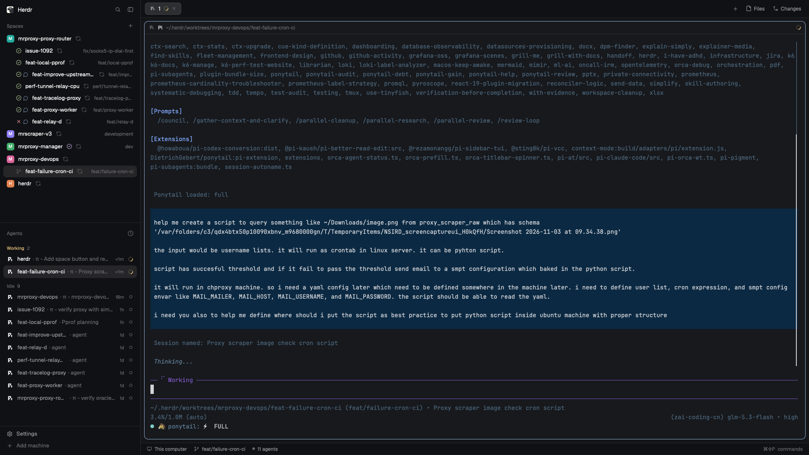

# GitHub Spaces: build brief

Two mods, split by job. A sidebar is exactly one mod, so they meet through shared state:

- **`spaces-stacks`** draws the spaces: rows, machine groups, the worktree tree, stacked PRs, the branch switcher, the fetch arrow.
- **`github-spaces`** answers GitHub: the PR on each checkout, checks, conflicts, review state, human comments. It draws nothing except the comment cards and toasts.

This is a build brief, not an installation guide. See [README](../github-spaces/README.md) and [Spaces Stacks](../spaces-stacks/README.md) for installation, controls, and limits.

## The contract

| Shared key | Writer | Reader | Shape |
| --- | --- | --- | --- |
| `spaces.git` | sidebar | info | `where()` → `{ on, repo, branch, linked, spaces: [{ id, name }] }` |
| `github-spaces.prs` | info | sidebar | `` `${repo}|${branch}` `` → `{ number, url, state, base, conflict, ci, approved, attentionIds }` |
| `github-spaces.comments` | info | sidebar, cards | space id → saved cards, `attentionIds`, `dismissedIds` |
| `github-spaces.hold` | info | sidebar | ms until polling resumes |

`setShared` re-renders every mod, so every writer compares its JSON first. `where()` is `JSON.stringify([machine, folder])`, the same key both mods already used for git state.

Mods cannot call each other. To ask the other copy to look again: `run("<mod>.<command>")` delivers to that mod's `nextCommand()`.

## Install shape

- The sidebar block uses `spaces-stacks`.
- `github-spaces` is mounted as a `1px` block (`{"id":"github-info","type":"block","size":{"px":1}}`), like `panel-keys`: mounted means its timers run.
- Five floating comment-card blocks use `github-spaces` with `props.role: "comment"`.
- No shipped layout or key binding changes. The refresh key stays `github-spaces.refresh`; the info mod forwards to `spaces-stacks.refresh`.

## Sidebar: `spaces-stacks`

Start from Herdr's shipped `spaces` mod; never edit the original. Keep its selection, drag, menus, machine groups, reconnect, rail, scroll-to-active, and ordering sync.

### Git

`git rev-parse --show-toplevel` and `--git-common-dir` name the repo; `symbolic-ref` names the branch; `rev-list --left-right --count HEAD...@{upstream}` gives ahead/behind. Counts are against the last fetched upstream, not the PR base. Do not auto-fetch.

### Stack forest

`ordered()` builds the rows:

- A worktree's parent is the row in the same repo whose branch equals its PR's `base` (`baseRefName`). Git stores no worktree parent.
- Base equal to the main checkout's branch, no PR, or a base with no space → direct child of the main checkout.
- No main checkout space → worktrees stay at top level.
- Depth-first emission; a visited set breaks retargeted cycles.
- Rows carry `depth`; indent is `22 * depth`; nested rows are 28px, main rows 30px.
- Keep the existing reordering: move spaces to match the emitted order, once per second at most.

### Marks and arrow

Draw the PR mark from `github-spaces.prs`: conflict beats CI; merged and closed beat both; failed beats running beats passing. The attention bubble is `attentionIds` minus `dismissedIds` from the saved cards. Plain spaces show open PRs only; worktree rows show merged and closed too.

The fetch arrow is a row control: red with a count when strictly behind, blue otherwise, spinner while this mod's fetch/rebase runs. Run `git fetch`, then plain `git rebase`; never push, resolve or abort.

### Branch switcher

Main rows show their branch (`main`/`master` included) and clicking it opens `props.role === "branches"` as a popup of this mod. List `git for-each-ref --format=%(refname:lstrip=2)%09%(worktreepath) refs/heads`:

- current branch → close;
- branch with a worktree path that belongs to a space → `space.select` that space;
- otherwise `git switch --no-guess <branch>`; refuse while a pane in the space is `status === "working"`;
- failures show git's words; close nothing but the popup on success, then `run("spaces-stacks.refresh")`.

The popup is a separate copy: give it its own `InputState`, focus handle, and root `track_focus`; Esc closes popups.

### Publishing

`publish()` writes `spaces.git` on change from the git refresh — never from render, since a write re-renders every mod and render already reorders spaces. Keys and the spaces inside each entry are sorted, so a reorder alone writes nothing. Keep every space on a shared checkout: the info mod keys its answer per checkout but keeps one card per space.

## Info: `github-spaces`

Keep: batched `pullRequest` query (add `baseRefName`), the `gh pr view` fallback (same field), comment activity pagination, review threads, bot/own/author filtering, attention rules, backoff, budget tally, merge prompts, dock state, notifications.

Drop: every row, group, menu, machine, git-status and fetch control. Read checkouts from `spaces.git` on a short timer (15 s) and poll GitHub when the set changes; re-poll every two minutes. Publish `github-spaces.prs` on each answer and on a confirmed no-PR, so old marks disappear. Write nothing when the JSON is unchanged.

Keep the guard: an answer for a branch the checkout already left is dropped.

### `updatedAt` gate

Activity lists are fetched only when `updatedAt` moved or no complete read exists. Thread resolution is re-read while attention is non-empty, because resolving does not move `updatedAt`. A partial endpoint answer keeps the previous snapshot; it is never read as resolved.

### Comment counts

Attention = unresolved human comments newer than the PR's latest commit, on an open PR. Publish the ids; the sidebar subtracts cards the person closed. Cards keep the latest five. A first comment on a comment-free PR notifies; a comment that arrived while Herdr was closed notifies once.

## Done when

1. `node github-spaces/test-branch-status.cjs` and `node spaces-stacks/test-stacks.cjs` pass.
2. `herdr-app check` passes on both installed mods, status reports no errors.
3. A live sidebar shows PR marks and comment badges from the info mod; rows still select, drag, reorder, and group by machine.
4. A two-deep stack nests from PR bases; a retargeted PR moves one poll later; a branch with no PR stays flat.
5. The branch popup switches a free branch, jumps to a worktree on a taken branch, refuses while an agent works, and a failed switch toasts git's words.
6. Merged worktrees still prompt once, comment cards still close and count, and notifications still select the space.

Headless checks do not prove live notification or popup behaviour. Exercise those transitions separately.
