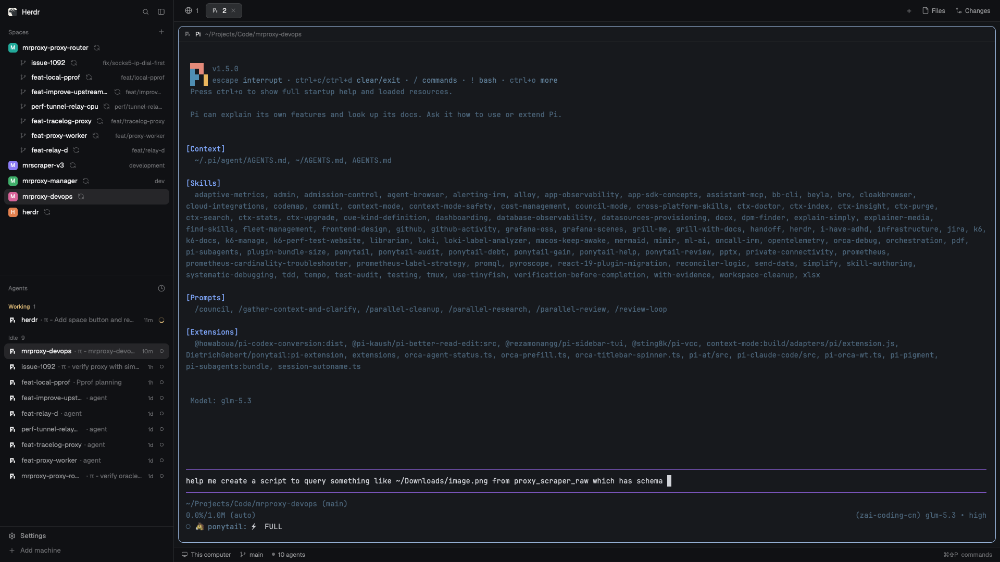

# GitHub spaces

The Spaces sidebar, plus GitHub: every repo space shows its branch's PR — checks failed red, running, passing green, merged purple — a bubble for comments not read yet, a one-click `git fetch + rebase` beside the name, and when a PR merges, the worktree's removal is offered to you. A drop-in replacement for the shipped `spaces` mod, built by cloning it.

This file is the brief: enough to build GitHub spaces from an empty folder. The files next to it are one build of it. If they don't work on your Herdr, or you want it different, build it again from here.

## What you see

The usual Spaces sidebar: colored avatars, worktrees nested under their main checkout, machine headers, repo · branch · ↑ahead ↓behind after each name. On top of that, for every space inside a git repository:

- After the space's name (main-checkout rows) or in place of the branch icon (worktree rows): the PR mark.
  - `x` in red — the PR's checks failed.
  - a small spinning ring in yellow — checks still running.
  - a circle-check in green — checks passing.
  - a circle-check in purple — the PR merged.
  - a minus, dim — the PR closed without merging.
- A speech bubble in the accent color beside the mark while the PR has a comment you haven't read; opening the space reads it.
- A sync icon, dim, right of the name: hover highlights it, its tooltip says "git fetch + rebase". While it runs it spins in the accent color.

Marks carry tooltips: "PR #944 · checks passing". A branch without a PR shows exactly what the shipped sidebar shows (the branch icon on worktree rows, nothing extra on main rows).

## How it behaves

- Every two minutes, each repo space's branch is looked up once with `gh pr view` (one call per place, whether or not the window is in front — marks are there when you come back to look).
- A PR that merges while you run this: a notification ("PR #944 merged … Delete its worktree?") and, for a linked worktree, Herdr's own Remove-worktree dialog opens (with its uncommitted-changes and unpushed-submodule warnings). Main checkouts get the notification only. Each merged PR asks once, ever — remembered in the mod's `localStorage`.
- A new comment by anyone but you: one notification (clicking it selects the space) and the bubble until you open that space. Your own comments never notify. The first look at a place is quiet: old merges and old comments never pop up.
- The sync button runs `git fetch`, then `git rebase` on the branch's own configured upstream, one space at a time. Git's refusals (dirty tree, conflicts mid-rebase, branch without upstream) become an error toast with git's own words — nothing is force-pushed, aborted or thrown away. After a run, every checkout of that repo re-derives its ahead/behind.
- A machine where `gh` cannot start is skipped for half an hour, then tried again; its spaces simply show no PR marks.

## Built from

- **A clone of the shipped `spaces` mod** (`herdr-app do mod.clone '{"name":"spaces","as":"github-spaces"}'`), then these additions to `main.js`:
  - `readPR(j)`: one `gh pr view --json number,state,statusCheckRollup,comments` answer → checks verdict (any FAILURE/TIMED_OUT/ACTION_REQUIRED/ERROR beats any IN_PROGRESS/QUEUED/PENDING/WAITING/null beats the rest) and the last comment with its author.
  - `pollPRs(cx)`: the two-minute `cx.timer` (skipped only under headless `check`, where `window()` is null), one `exec("gh", …, { cwd, on })` per place, in-flight deduped; gh's "no pull requests found" / "not a github repository" / "no git remotes found" are remembered as *no PR*, other failures keep the last answer.
  - `speak(s, key, g)`: state changes → `notify({ title, body, level, action: { name: "space.select", args: { id } } })` and `openOverlay({ mod: "worktree", kind: "dialog", width: 440, height: 260, props: { space, action: "remove" } })`; first looks only seed `localStorage` (`pr.merged.done`, `pr.comment.seen`, `pr.comment.read`).
  - `prMark(pr, g, t)` / `readPrComments({k, g})` / `fetchButton(w, t)` / `fetchRebase(w, cx)`: the row marks, the bubble's read-on-open, and the button (`exec("git", ["fetch"])` then `exec("git", ["rebase"])` with `{ cwd, on }`, then `refreshGit(sameRepo(...))`).
- **Two icons of its own**, `mods/github-spaces/sync.svg` and `comment.svg` (lucide-style, `stroke="currentColor"`, so `svg(path).text_color()` tints them). Other marks reuse shipped `mods/workspace-chrome/` icons: `x`, `circle-check`, `spinner` (`.spin(900)` while checks run), `minus`.
- **From `herdr`:** `exec` (gh, git; `on: space.machine` for remote spaces), `notify`, `openOverlay`, `run("space.select")`, `spaces`, `panes`, `theme`, `window`, and `localStorage`.
- **To install:** copy `mods/github-spaces/` into `~/.config/herdr-app/mods/`, then point your layout's spaces sidebar block at it (`"content": { "mod": "github-spaces" }`). No keys, no other layout changes. Needs `gh` (installed and logged in) and `git`.

## Watch out

- `window()` is `null` under `herdr-app check` — return early there, or the check fails before rendering. But don't gate polling on `window().active` ("in front"): a window used in the background never polls and its marks stay empty.
- The shipped `spaces` mod is read-only and restored on every start: always clone, edit the clone, and let the layout reference the clone's name.
- `gh pr view` exits 1 for "no PR" and for real errors alike; only its three known "no PR" messages may be remembered as no-PR, or a network hiccup would blank the marks until the next poll.
- The fetch button lives inside the row's own press/drag/select mouse handlers: `stop_propagation` on both `mouse_down` and `click`, or a rebase also selects the space.
- Rows are keyed by place, `JSON.stringify([machine, cwd])`: a space whose first terminal `cd`s away is a new place and starts with a quiet first look.
- Marks are skipped for machines where gh can't start — check `gh auth status` there before wondering why a remote space shows nothing.

## Done when

- `herdr-app check ~/.config/herdr-app/mods/github-spaces` passes and `herdr-app status` shows no mod errors.
- A repo space with an open PR shows its mark (tooltip names the PR); a branch without a PR looks like the shipped sidebar.
- The sync button spins while a fetch/rebase runs, the row's ↓behind updates after, and a dirty tree produces git's own refusal in a toast.
- Merging a PR while running produces one notification and, on a worktree, the Remove-worktree dialog — exactly once, never again after restart.
- A comment from another account notifies once and leaves a bubble that clears when the space is opened.
