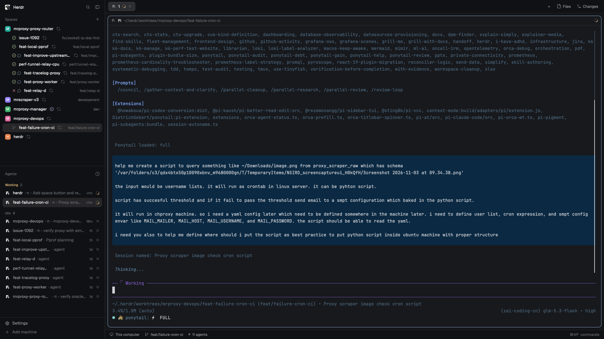

# Spaces Stacks

The Spaces sidebar, with stacked PRs shown as a tree and a branch switcher on each main checkout.

The rows are this mod. GitHub facts — the PR mark, the comment badge, the budget-hold note — come from [`github-spaces`](../github-spaces/README.md), which must be installed too: it is what asks `gh`, and this mod only draws what it publishes. The fetch arrow and ahead/behind counts are this mod's own Git reads.



## Install

Requires Herdr and Git, plus the GitHub info mod:

1. Copy both mods into Herdr's configuration directory.

   ```sh
   mkdir -p ~/.config/herdr-app/mods
   cp -R spaces-stacks/mods/spaces-stacks ~/.config/herdr-app/mods/
   cp -R github-spaces/mods/github-spaces ~/.config/herdr-app/mods/
   ```

2. In your **personal layout**, change the spaces block's `content` to:

   ```json
   { "mod": "spaces-stacks" }
   ```

   Do not edit a shipped layout. If you use the shipped `main` layout, clone it first:

   ```sh
   herdr-app do layout.clone '{"name":"main","as":"main-stacks"}'
   ```

3. Add a 1px block for the info mod. It draws nothing; it only needs to be mounted so its polling runs. Next to your `panel-keys` block (or any block of the sidebar column):

   ```json
   { "id": "github-info", "type": "block", "size": { "px": 1 }, "content": { "mod": "github-spaces" } }
   ```

4. Keep the comment-dock blocks from `github-spaces`: five `floating` entries with `props: { "role": "comment", "slot": 0 }` … `4`, as described in the [GitHub Spaces README](../github-spaces/README.md#comment-cards).

5. Validate and reload:

   ```sh
   herdr-app check ~/.config/herdr-app/mods/spaces-stacks
   herdr-app check ~/.config/herdr-app/mods/github-spaces
   herdr-app status
   ```

Both mods are separate copies from this repository; changing one here does not update the installed one.

## Stacked rows

A worktree nests under the worktree whose branch its PR targets:

```
GitHub Spaces        main  ↓2
  ├─ stack/1         ✓ #12
  │   └─ stack/2     ✓ #13
  └─ fix/tabs        ✗ #14
```

- Depth comes from the PR's base branch (`baseRefName`), the only reliable stack signal: Git records no parent for a worktree.
- A PR based on the default branch sits directly under the main checkout.
- No PR on the branch, or a base branch with no space here → direct child of the main checkout.
- A repo with no main checkout space roots the tree at each worktree whose parent is not among the spaces; a worktree whose base is another worktree here still nests under it.
- Two PRs retargeted at each other cannot loop: each space appears once.
- Clicking a row with worktrees under it selects that space and folds or unfolds its subtree; its trailing chevron does the same without switching. Leaf rows only select. Folds are remembered per space and survive reloads.
- A folded row keeps its line; its hidden worktrees are still reordered, polled and counted as usual. The compact rail ignores folds and lists every space.
- Hover a mark for its PR number and status.

Nesting is as fresh as the last poll (two minutes, or the repo row's **↻** control). A retargeted PR moves one cycle later.

## Branch switcher

A main checkout's row shows its branch name, including `main`/`master`, and it is clickable. The popup lists local branches:

| Pick | What happens |
| --- | --- |
| The current branch | Closes. |
| A branch checked out in another worktree | Selects that worktree's space instead — git cannot check out one branch twice. |
| Any other branch | Runs `git switch --no-guess <branch>` there. |
| Anything while an agent is working in that space | Refuses with a toast. Let the agent finish first. |

Errors show git's own words. Nothing is forced, stashed or discarded. Local branches only: this mod does not create tracking branches from remotes.

A nested row shows its branch too when its name is not that branch (`daily proxy usage reporter` on `chore/daily-report`). A worktree named exactly after its branch repeats nothing. Only main rows offer the switcher.

## Other controls

Kept from the shipped sidebar: selection, drag-to-reorder, right-click menu, machine groups with reconnect and login notes, the compact rail, scroll-to-active, and automatic reordering to match the tree.

The download-arrow button beside each repo's name runs `git fetch` then `git rebase` against the branch's configured upstream, and is red with a count while strictly behind. It never pushes, resolves conflicts or aborts.

The **↻** button on a repo's top row asks GitHub for every branch in that repository again — all its worktrees, marks and counts — not just the branch you clicked. It spins for a moment; the marks move when the answer lands. There is no global refresh key. A paused budget answers with a toast instead.

## Limits

- **No PR marks or marks that lag:** the info mod polls every two minutes. Check `gh pr view` in the checkout and `gh auth status`; see the [GitHub Spaces README](../github-spaces/README.md#limits-and-troubleshooting).
- **Stacks need PRs.** Without a PR, a worktree is flat under its main checkout; local commit ancestry is not guessed.
- **A parent row toggles on every click.** Switching to a repo or worktree that has a stack folds or unfolds it too; the chevron folds without switching.
- **A folded stack hides its rows.** If the active space is inside it, the space stays selected but its row is out of view until you unfold; nothing scrolls to it.
- **Branch counts** are Git's, against the last fetched upstream — not the PR's base branch.
- **A space named exactly after its branch** hides the branch label, so it offers no switcher there.

This is trusted code: it runs `git rev-parse`, `git rev-list`, `git fetch`/`rebase` and `git switch` on your checkouts. Status changes alone never fetch, rebase, switch or delete anything.

## Development

`main.js` starts from a copy of Herdr's shipped `spaces` mod; never edit the shipped original. The added paths are `ordered()` (the forest), `prFor()`/`prMark()` (marks from shared state), `fetchButton()`/`fetchRebase()`, `opened()`/`foldButton()` (folded stacks), and the `branches` role (`initBranches`, `pick`, `spaceOn`).

From the repository root:

```sh
node spaces-stacks/test-stacks.cjs
node github-spaces/test-branch-status.cjs
git diff --check
herdr-app check ~/.config/herdr-app/mods/spaces-stacks
```

The stacks check covers stack depth from PR bases, unknown bases, missing main checkouts, retargeted cycles, folding a parent row (subtree hidden, order untouched, fold remembered and cleaned up, hidden active space not scrolled to), marks from published data, dismissed badges, and Git ahead/behind arrows. It does not cover the live popup or real click targets; exercise the picker, a chevron, and a two-deep stack in the real sidebar.

### Shared state

| Key | Written by | Read by |
| --- | --- | --- |
| `spaces.git` | this mod | `github-spaces` |
| `github-spaces.prs` | `github-spaces` | this mod |
| `github-spaces.comments` | `github-spaces` | this mod (dismissed cards) and the comment cards |
| `github-spaces.hold` | `github-spaces` | this mod (header tooltip) |
| `github-spaces.want` | this mod (repo row ↻) | `github-spaces` |

`spaces.git` maps a checkout to `{ on, repo, branch, linked, spaces: [{ id, name }] }`. `github-spaces.prs` maps `` `${repo}|${branch}` `` to `{ number, url, state, base, conflict, ci, approved, attentionIds }`. Both are written only when they change; a write re-renders every mod.
